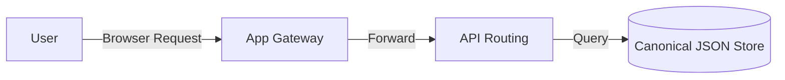

# Architecture Document: [System Name]

*   **Status**: [Draft | Under Review | Approved | Superseded]
*   **Date**: YYYY-MM-DD
*   **Deciders**: [Authors]

---

## 1. Executive Summary

[Provide a high-level summary of the architectural layer or system cluster being documented. What is the scope, and what are the main architectural choices?]

---

## 2. Layer Diagram

[Show the layers of this system. E.g., Foundation, Engine, Applications.]

```
+-------------------------------------------------------------+
|                      Applications                           |
|       (Next.js Pages, Resume Builder, CLI tools)            |
+-------------------------------------------------------------+
                              |
                              v
+-------------------------------------------------------------+
|                         Engine                              |
|   (RAG pipelines, Ingestion scripts, Knowledge Graph)       |
+-------------------------------------------------------------+
                              |
                              v
+-------------------------------------------------------------+
|                       Foundation                            |
|       (Principles, Schemas, Core data models)               |
+-------------------------------------------------------------+
```

---

## 3. Core Data Flow & Diagrams

[Include Mermaid diagrams representing the data flow, state changes, or API request loops.]



---

## 4. Subsystem Interactions

[Detail how specific components communicate, including protocols (HTTP/REST, Wasm bindings, file reads) and data payloads.]

---

## 5. Cross-Cutting Concerns

*   **Error Handling**: [How are errors bubbled up and logged?]
*   **Localization (i18n)**: [How are UI strings mapped to locale files?]
*   **Observability**: [How is search performance or API latency tracked?]
