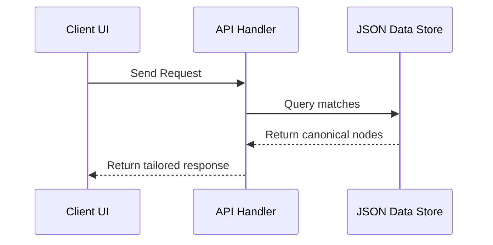

# Specification: [Subsystem Name]

*   **Status**: [Draft | Under Review | Approved | Superseded]
*   **Date**: YYYY-MM-DD
*   **Owner**: [Author Name/Role]

---

## 1. Overview and Motivation

[High-level summary of the subsystem. What business value does it bring? What problem does it solve? How does it fit into the overall Mentat Commons architecture?]

---

## 2. Scope: Goals and Non-Goals

### Goals
*   [Goal 1, e.g. Maintain a single source of truth for project metrics]
*   [Goal 2, e.g. Support low-latency client-side querying]

### Non-Goals
*   [Non-Goal 1, e.g. Building an automated external social media poster]
*   [Non-Goal 2, e.g. Implementing a multi-tenant user authentication system]

---

## 3. Data Model & Schema

[Specify the data structures using TypeScript interfaces, JSON schemas, or database tables.]

```typescript
// Example interface
interface SubsystemEntity {
  id: string;
  created_at: string;
  metadata: Record<string, any>;
}
```

---

## 4. System Interface (APIs & UI)

### Public API Endpoints
*   `POST /api/subsystem/action`
    *   **Request body**: `{ param: string }`
    *   **Response**: `{ success: boolean }`

### UI Components & Presentation
[List any UI views or reusable components introduced by this subsystem.]

---

## 5. Sequence Flows & Logic

[Describe the algorithmic logic or sequence diagrams mapping out key operations.]



---

## 6. Security, Privacy & Performance

*   **Privacy constraints**: [e.g., Anonymizing license plate numbers locally]
*   **Performance metrics**: [e.g., Ensuring database parsing takes under 10ms]

---

## 7. Verification & Testing Strategy

*   **Static verification**: [e.g., Validating JSON payload against schema.json]
*   **Unit tests**: [e.g., Testing RAG retrieval sorting correctness]
