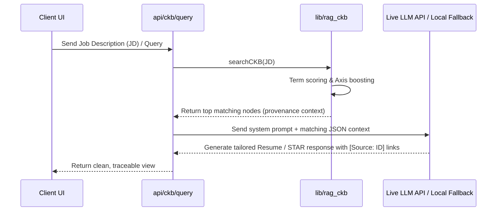

# Specification: Career Evidence Graph (CEG)

*   **Status**: Approved
*   **Date**: 2026-07-02
*   **Owner**: Nandhini Anand (Architect), Antigravity (AI Co-Architect)
*   **Related ADRs**: None

---

## 1. Overview and Motivation

The **Career Evidence Graph (CEG)** is the foundation of the Mentat Commons professional memory subsystem. Modern portfolios and resumes are typically structured as static, duplication-heavy documents customized for individual opportunities. This leads to information drift, inconsistent dates, and untraceable claims.

The CEG addresses this by treating professional history as a structured, immutable database of **evidence**. Rather than maintaining resumes, the developer maintains a canonical JSON dataset. Downstream artifacts—such as tailored resumes, cover letters, capability statements, and behavioral interview sheets—are treated as generated **views** of this underlying graph.

### 🛡️ Core Philosophy
> *Never rewrite history. Reorganize and retrieve it.*

Every professional activity, project outcome, public talk, and workshop is entered into the graph exactly once. The system generates custom documents by searching, filtering, and organizing these factual blocks, appending trace markers back to the source entities. No hallucinated experience is permitted.

---

## 2. Scope: Goals and Non-Goals

### Goals
*   Establish a canonical, schema-validated JSON data store for professional history.
*   Support dynamic, multi-criteria node navigation (by Axis, Organization, Technology Stack, Domain, and Entity Type).
*   Equip the presentation layer with self-surfacing related entities to allow fluid knowledge-graph traversal.
*   Build a retrieval API supporting semantic keyword querying, STAR interview layout structuring, and tailored resume generation.
*   Ensure every generated bullet point links back to its verified CKB trace ID.
*   Provide a dedicated showcases layout for **Axelrod's Razor** (game-theory, in-browser simulations, screenshot lightbox viewer).

### Non-Goals
*   Real-time external synchronization with platforms like LinkedIn or GitHub (local file repository remains the single source of truth).
*   Automated applicant tracking system (ATS) submittal (the platform generates documents; the user submits them).

---

## 3. Data Model & Schema

All data is structured in [career_knowledge_base.json](file:///home/bobbyd/playspace/mentat-commons/data/career_knowledge_base.json) and validated by [schema.json](file:///home/bobbyd/playspace/mentat-commons/data/schema.json).

```typescript
type CareerAxis = 'axis-i' | 'axis-ii' | 'axis-iii';

interface Experience {
  id: string;              // Unique trace identifier (e.g. 'exp-bene-data')
  organization: string;    // Company, studio, or collective name
  role: string;            // Professional title
  start_date: string;      // Start year/date
  end_date: string;        // End year/date (or 'Present')
  summary: string;         // Short paragraph summary
  responsibilities: string[]; // List of core responsibilities
  deliverables: string[];  // Tangible assets built/shipped
  technologies: string[];  // Stack utilized
  stakeholders: string[];  // Client types or internal roles managed
  outcomes: string[];      // Verified metrics and outcomes
  domains: string[];       // Professional sectors (e.g., Data Engineering, Systems Design)
  leadership_examples: string[]; // Situations demonstrating direction/governance
  evidence_links: string[]; // URLs to public artifacts, codebases, or mentions
  axes: CareerAxis[];      // Mapped career vectors
}

interface Project {
  id: string;              // Unique identifier (e.g. 'proj-axelrod')
  title: string;           // Project name
  organization: string;    // Parent organization ID/Name
  problem: string;         // The core system challenge being addressed
  context: string;         // System constraints, environment, and stakeholders
  solution: string;        // Detailed explanation of the technical solution built
  architecture: string;    // Technical architecture summary (Rust, Wasm, PyTorch, etc.)
  decisions: string;       // Key engineering decisions made
  tradeoffs: string;       // Design tradeoffs and constraints accepted
  technologies: string[];  // List of tech utilized
  outcomes: string[];      // Quantifiable system outputs
  impact: string[];        // Wider business or organization effects
  reusable_stories: string[]; // Story arcs for interviews
  interview_questions_supported: string[]; // Behavioral questions this project answers
  screenshots: Array<{ url: string; caption: string }>; // Screenshots for visual gallery
  links: Array<{ name: string; url: string }>;         // Live project links
  evidence: string[];      // Concrete proofs (Git repos, policy papers, slides)
  axes: CareerAxis[];      // Mapped axes
}

interface SkillDetails {
  yearsOfExperience: number;
  confidence: 'Beginner' | 'Intermediate' | 'Advanced' | 'Expert';
  description: string;
  projects: string[];      // Array of experience or project IDs using this skill
}

interface Skill {
  [skillName: string]: {
    categories: Record<string, SkillDetails>;
    totalYears: number;
  };
}

interface Talk {
  id: string;
  topic: string;           // Title of presentation
  audience: string;        // Venues and attendee counts
  duration: string;        // Talk length
  abstract: string;        // Paragraph summary of contents
  slides: string;          // Link to presentation deck
  recordings: string;      // Video/Audio link
  lessons: string;         // Key insights shared
  related_projects: string[]; // Project IDs
  axes: CareerAxis[];
}

interface Community {
  id: string;
  name: string;            // Name of community initiative
  volunteering?: string[]; // Voluntary actions
  theatre?: string[];      // Theatre/applied improv activities
  facilitation?: string[]; // Moderation and restorative circle keeping
  partnerships?: string[]; // Organizations collaborated with
  workshops?: string[];    // Educational sessions led
  organizing?: string[];   // Events structured
  axes: CareerAxis[];
}

interface WritingItem {
  id: string;
  title: string;
  summary: string;
  content?: string;
  axes: CareerAxis[];
}

interface Writing {
  articles: WritingItem[];
  essays: WritingItem[];
  research_notes: WritingItem[];
  stories: WritingItem[];
  blog_posts: WritingItem[];
  talk_proposals: WritingItem[];
  white_papers: WritingItem[];
}
```

---

## 4. Career Axes Mapping

The CEG maps entities across three vectors. When an entity (project, talk, writing) is mapped to an axis, it inherits query boosts under related queries.

*   **Axis I — Technical Leadership**: Mapped to engineering architecture, data pipelines, and MLOps. Focuses on technological strategy and system stability.
*   **Axis II — Human Systems**: Mapped to training, collaboration, writing, applied improv, and restorative dialogue circles. Focuses on institutional capability transfer.
*   **Axis III — Decision Systems**: The intersection of technology, cognition, and organization design. Mapped to game theory sandboxes (Axelrod's Razor), cognitive science talks, and pre-decision containment advisory.

---

## 5. System Interface & Presentation Layer

The presentation layer in [page.jsx](file:///home/bobbyd/playspace/mentat-commons/app/career/page.jsx) is split into two panels:

### Left Panel: Multi-Index Navigator
Supports node grouping by:
1.  **Entity Category**: Renders nodes sorted by Experiences, Projects, Skills, Talks, Community Work, and Writing.
2.  **Narrative Axis**: Focuses on items associated with Axis I, II, or III.
3.  **Organization**: Focuses on items mapped to parent companies.
4.  **Technology Stack**: Groups projects/experiences by primary languages/tools (Python, Rust, Wasm).
5.  **Professional Domain**: Filters by sectors (Systems Design, Decision Design, ML, etc.).

### Right Panel: Interactive Details View & Related Entities
*   Renders the selected node's schema properties (e.g. problem, solution, decisions, outcomes).
*   **Self-Surfacing Related Nodes**: Traverses the graph data arrays to automatically display related nodes. Clicking a related tag redirects the view, allowing seamless graph navigation.
*   **Visual Project Gallery**: If `proj-axelrod` is selected, renders visual mockup screenshot cards. Clicking a card opens a full-screen **Lightbox Modal** displaying detailed captions and game-theory grid configurations.

---

## 6. Sequence Flows & Logic

### View Tailoring Sequence


---

## 7. Security, Performance & Verification

*   **Data Integrity**: Staging changes in [career_knowledge_base.json](file:///home/bobbyd/playspace/mentat-commons/data/career_knowledge_base.json) must be verified against [schema.json](file:///home/bobbyd/playspace/mentat-commons/data/schema.json) before merging.
*   **API Latency**: Local search indexing performs in `< 5ms`, enabling near-instantaneous search results.
*   **Localization Alignment**: All text labels and descriptions displayed in the UI must resolve via `t('ckb.key')` helper strings mapping to [en.json](file:///home/bobbyd/playspace/mentat-commons/locales/en.json).
