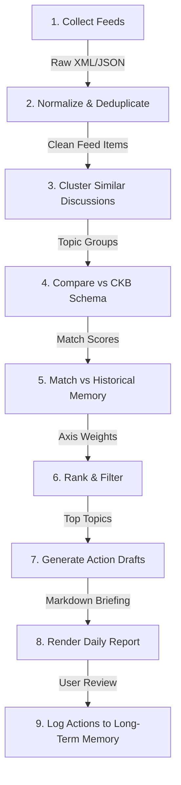

# Specification: Mentat Commons Conversation Radar

*   **Status**: Draft
*   **Date**: 2026-07-07
*   **Owner**: Nandhini Anand (Architect), Antigravity (AI Co-Architect)
*   **Related ADRs**: [ADR 0002: Conversation Radar Storage Engine](file:///home/bobbyd/playspace/mentat-commons/docs/adr/0002-conversation-radar-storage.md)

---

## 1. Overview and Motivation

The **Mentat Commons Conversation Radar** is a local-first, privacy-respecting research assistant. Its purpose is to continuously scan technical, organizational, and AI-related conversations across the web and identify high-quality opportunities for the user to contribute genuine expertise.

### 🛡️ Design Philosophy
*   **Optimize for**: System thinking, learning, discovery, pattern recognition, and long-term reputation.
*   **Avoid**: Engagement farming, auto-posting, spamming, and viral clickbait.
*   **Human-in-the-Loop**: The agent **never** publishes content directly. It filters, summarizes, aligns topics with the user's historical evidence, drafts recommendations, and lets the human make the final publishing decision.

---

## 2. Scope: Goals and Non-Goals

### Goals
*   Implement ingestion connectors for RSS, Hacker News, Reddit, GitHub Trending, arXiv, and major AI blogs (OpenAI, Anthropic, Google AI, Microsoft Research, AWS, Azure).
*   Build a pipeline that deduplicates, clusters, and detects recurring themes across feeds.
*   Develop a semantic ranking engine that scores topics based on their overlap with the **Career Evidence Graph (CEG)**.
*   Synthesize a structured daily morning briefing highlighting top opportunities, consulting entry points, and research questions.
*   Draft high-quality LinkedIn post recommendations that highlight tension, misconceptions, organizational implications, and evidence links from the user's past projects.
*   Maintain a long-term memory store tracking recurring themes, ideas for workshops/services, and past written work.

### Non-Goals
*   Automated scheduling or API posting to LinkedIn, X (Twitter), or blogs.
*   Generating generic AI commentary (all drafts must incorporate specific CEG evidence).
*   Scraping private user data or locked forums.

---

## 3. Storage Schema & Data Model

As decided in [ADR 0002](file:///home/bobbyd/playspace/mentat-commons/docs/adr/0002-conversation-radar-storage.md), the system uses a relational database model (SQLite locally / Cloudflare D1 in production).

```sql
-- Feed Sources Config
CREATE TABLE radar_sources (
  id TEXT PRIMARY KEY,
  name TEXT NOT NULL,
  url TEXT NOT NULL,
  source_type TEXT NOT NULL, -- 'rss' | 'hn' | 'reddit' | 'github' | 'arxiv'
  active INTEGER DEFAULT 1
);

-- Ingested Feed Items
CREATE TABLE radar_items (
  id TEXT PRIMARY KEY,
  source_id TEXT,
  title TEXT NOT NULL,
  url TEXT NOT NULL UNIQUE,
  author TEXT,
  content_raw TEXT,
  published_at TEXT,
  ingested_at TEXT DEFAULT CURRENT_TIMESTAMP,
  FOREIGN KEY(source_id) REFERENCES radar_sources(id)
);

-- Discussion Clusters (Daily Run output)
CREATE TABLE radar_clusters (
  id TEXT PRIMARY KEY,
  date TEXT NOT NULL,
  title TEXT NOT NULL,
  summary TEXT NOT NULL,
  item_ids TEXT NOT NULL, -- JSON array of radar_items.id
  relevance_score REAL,
  novelty_score REAL,
  confidence_score REAL,
  matches_ceg TEXT, -- JSON array of matched CEG entity IDs (projects/experiences)
  suggested_action TEXT, -- 'ignore' | 'comment' | 'linkedin' | 'blog' | 'workshop' | 'consulting'
  linkedin_draft TEXT -- JSON representing LinkedIn post suggestions
);

-- Long-Term Memory
CREATE TABLE radar_memory (
  id TEXT PRIMARY KEY,
  topic_name TEXT NOT NULL UNIQUE,
  first_seen TEXT NOT NULL,
  last_seen TEXT NOT NULL,
  occurrence_count INTEGER DEFAULT 1,
  notes TEXT,
  ideas_generated TEXT -- JSON array of workshop/consulting ideas
);
```

---

## 4. Processing Pipeline

The daily morning briefing runs through a 9-step pipeline:



### Ingestion Details
*   **Hacker News**: Fetch the top 100 story metadata via the official Firebase API.
*   **Reddit**: Fetch `/r/MachineLearning`, `/r/kubernetes`, `/r/cognitive_science`, `/r/artificial` RSS feeds.
*   **arXiv**: Query the API for papers in computer science (`cs.AI`, `cs.LG`, `cs.SE`).

### Ranking & Scoring Engine
Each cluster is scored against the **Career Evidence Graph** using the following weighting factors:
$$\text{Score} = (W_{\text{term}} \times S_{\text{overlap}}) + (W_{\text{axis}} \times S_{\text{axis\_boost}}) + (W_{\text{novelty}} \times S_{\text{novelty}})$$

Where:
*   $S_{\text{overlap}}$: Match count of terms between the cluster's text and the user's project descriptions, skills, and writing summaries.
*   $S_{\text{axis\_boost}}$: Boost multipliers if the cluster intersects with the core **Career Axes** (Axis I: Technical Leadership, Axis II: Human Systems, Axis III: Decision Systems).
*   $S_{\text{novelty}}$: Higher score if the topic hasn't been written about before (queried against historical writing in the CKB).

---

## 5. LinkedIn Suggestions Format

When the pipeline suggests a LinkedIn post, the generator prompt enforces structural constraints to avoid generic AI-speak:

1.  **Tension**: State the core conflict (e.g., *Devs want local speed vs. compliance wants centralized checks*).
2.  **Misconception**: Call out the industry myth (e.g., *Adding more governance tools fixes developer quality*).
3.  **Hidden Trade-off**: Explain what is silently sacrificed (e.g., *Security gates reduce raw cycle times by 40%*).
4.  **Organizational Implication**: How it changes day-to-day decision-making.
5.  **Evidence Attachment**: Must embed a citation link to a project in the CEG (e.g. `[Source: proj-axelrod]`).

```json
{
  "headline": "A Hook highlighting the core tension...",
  "argument": "The main technical/organizational stance...",
  "evidence": "How I solved this at [Company] during [Project ID]...",
  "mentatLinks": ["https://www.mentatcommons.com/career#proj-axelrod"],
  "hashtags": ["#SystemsThinking", "#DecisionDesign"],
  "readingTime": "2 min"
}
```

---

## 6. Daily Briefing Layout

The final generated file (stored locally at `briefings/YYYY-MM-DD.md`) outputs the following format:

```markdown
# Conversation Radar: YYYY-MM-DD

## 🌟 Top Opportunities

### [Topic Title]
*   **Summary**: [Summary of the conversation]
*   **Why it matters**: [Why it is technically or organizationally significant]
*   **Why it matters to my consulting**: [Overlap with consulting services]
*   **Relevant CEG Evidence**: [Linked experience and projects, e.g. proj-axelrod]
*   **Suggested Action**: [LinkedIn Post | Blog | Research]
*   **Metrics**: Confidence: 85%, Novelty: 70%

---

## 📈 Emerging Themes
*   **Theme 1**: [Description, first seen date, occurrence count]

---

## 💼 Consulting Opportunities
*   [Potential client problem space and entry point strategies]

---

## 🔬 Research & Content Ideas
*   [Deeper topics to write about or workshop outlines]
```

---

## 7. Verification & Testing Strategy

*   **Deduplication Tests**: Feed the pipeline identical stories with different URL parameters (e.g. `?utm_source=rss` vs direct) and assert that only one item remains.
*   **Clustering Consistency**: Feed mock articles on three distinct subjects (Wasm rendering, restorative circles, and neural architecture search) and verify that they resolve into exactly three distinct clusters.
*   **Provenance Verification**: Verify that the generated LinkedIn suggestor JSON parser throws an error if the drafted post lacks a valid source reference to a project ID in the database.
*   **Database Migrations**: Write schema tests ensuring tables successfully migrate between SQLite (local dev environment) and Cloudflare D1.
