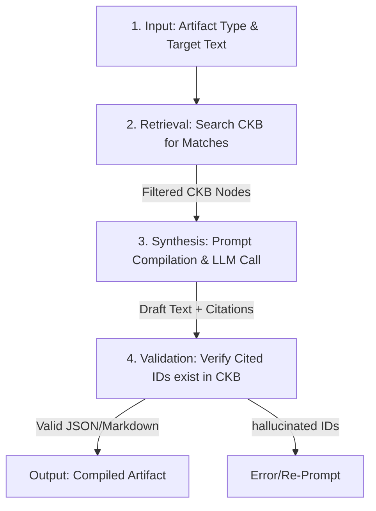

# Specification: Evidence Engine

*   **Status**: Proposed
*   **Date**: 2026-07-10
*   **Owner**: Nandhini Anand (Architect), Antigravity (AI Co-Architect)
*   **Related ADRs**: [ADR 0004: Evidence Engine Architecture](file:///home/bobbyd/playspace/mentat-commons/docs/adr/0004-evidence-engine-architecture.md)

---

## 1. Overview and Motivation

The **Evidence Engine** is the core compiler of the Mentat Commons platform. It treats the Career Knowledge Base (CKB) as a structured database of truth and compiles it into various professional artifacts (Resumes, Cover Letters, STAR Interview Notes, Consulting Proposals, and Speaker Bios) tailored to specific target inputs (e.g. a Job Description or a Client Problem Statement).

By transitioning the project from a "consultancy website" to an "Evidence Engine," we ensure that all external communications are built upon the same verified evidence, eliminating speculative claims and guaranteeing absolute truthfulness.

---

## 2. Scope: Goals and Non-Goals

### Goals
*   Implement a unified compile service (`lib/evidence_engine.mjs`) supporting multiple artifact targets: `resume`, `cover_letter`, `interview_notes`, `proposal`, `bio`, and `web_page`.
*   Establish a retrieval stage that matches CKB nodes to target input constraints using semantic keyword/axis overlap.
*   Enforce a **Truthfulness & Provenance Layer** that extracts and validates citations (e.g., `[Ref: proj-axelrod]`) in generated text.
*   Provide a CLI tool (`scripts/compile-artifact.mjs`) to compile artifacts from local files.
*   Provide a Next.js API endpoint (`/api/evidence/generate`) and integrate a **Workspace Dashboard** in the Web UI to let the user generate, review, and download artifacts.

### Non-Goals
*   Allowing the LLM to invent accomplishments, companies, or technologies (strict containment).
*   Automatically writing back to or modifying the primary `career_knowledge_base.json` database.

---

## 3. System Architecture & Compiler Flow

The engine compiles artifacts through a 4-stage pipeline:



### 1. Retrieval Stage
When given a target input (e.g. a Job Description or Client Problem), the engine extracts search terms and queries the CKB database using `searchCKB()`. It returns a ranked list of:
*   **Experiences** (`exp-*`)
*   **Projects** (`proj-*`)
*   **Writings** (`write-*`)
*   **Skills** (`skill-*`)

The top $N$ matching nodes are structured as JSON and injected into the LLM context.

### 2. Prompt Templates
The prompt templates enforce structural rules for each artifact type:

#### A. Resume Template
*   **Format**: Clean markdown sections (Summary, Experience, Projects, Skills).
*   **Rule**: Every bullet point under Experience or Projects **must** append a citation tag referencing the source CKB ID (e.g. `[Ref: proj-smart-waste]`).

#### B. Cover Letter Template
*   **Format**: Standard formal letter structure (Intro, Bridging Argument, Evidence, Closing).
*   **Rule**: The bridging section must explain how CKB projects address the key problems highlighted in the target Job Description.

#### C. STAR Interview Notes
*   **Format**: Grid of Situation, Task, Action, Result for top matched projects, plus answers to behavioral questions (Conflict, Ambiguity, Mentorship) backed by logged CKB stories.

#### D. Consulting Proposal
*   **Format**: Statement of Work structure (Problem Statement, Proposed Approach, Capabilities, Case Study/Credibility, Estimation framework).
*   **Rule**: Past project cases must be loaded directly from the CEG to support proposed solutions.

#### E. Speaker Bio
*   **Format**: Short (100 words), Medium (250 words), and Long (500 words) professional biographies, tailored to the target conference theme using CKB writing and talk nodes.

---

## 4. Interfaces & Data Models

### CLI Command Interface
```bash
npm run evidence:compile -- --type=resume --input=job_desc.txt --output=output/resume.md
```

### API Payload Schema (`POST /api/evidence/generate`)
```json
{
  "type": "resume" | "cover_letter" | "interview_notes" | "proposal" | "bio",
  "targetText": "The job description or client problem statement...",
  "options": {
    "template": "default" | "academic" | "executive",
    "includeDrafts": false
  }
}
```

### Response Schema
```json
{
  "success": true,
  "artifact": "# Generated Markdown Content...",
  "citations": ["proj-smart-waste", "exp-mentat-commons"],
  "validation": {
    "truthful": true,
    "unverifiedCitations": []
  }
}
```

---

## 5. Verification & Validation Rules

To guarantee **truthfulness**, the post-processing validation layer executes the following:
1.  **Tag Extraction**: Search the generated text for matches of the regular expression `/\[Ref:\s*([a-zA-Z0-9-_]+)\]/g`.
2.  **Referential Integrity Check**: Loop through all extracted IDs and assert that they exist in `career_knowledge_base.json`.
3.  **Hallucination Penalty**: If any citation ID does not exist in the database, strip the sentence or throw a validation warning to the user indicating a "hallucinated reference" was generated.
4.  **Metadata Injection**: Append an audit section at the bottom of the artifact listing all verified source CKB links.
