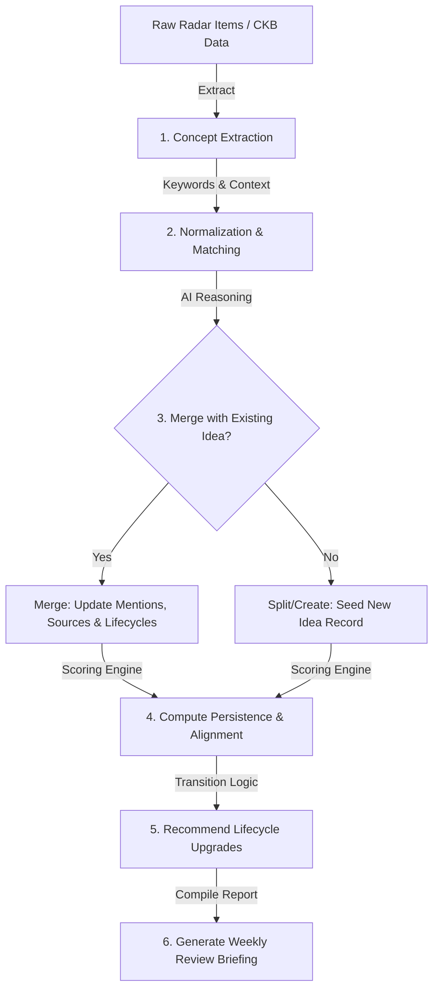

# Specification: Idea Incubator Module

*   **Status**: Draft
*   **Date**: 2026-07-07
*   **Owner**: Nandhini Anand (Architect), Antigravity (AI Co-Architect)
*   **Related ADRs**: [ADR 0003: Idea Incubator Design](file:///home/bobbyd/playspace/mentat-commons/docs/adr/0003-idea-incubator-design.md)

---

## 1. Overview and Motivation

The **Idea Incubator** is a local-first system designed to discover, track, and cultivate long-term intellectual capital. In contrast to tools that chase daily trending hashtags or clickbait, the Incubator operates under a core philosophy: **Ignore novelty, optimize for persistence**. 

It works on the hypothesis that truly important ideas tend to reappear across different industries, communities, and contexts over months and years, often under different names. By tracking these recurrences, the platform helps the user naturally discover what they are becoming known for, translating years of observation into enduring consulting capabilities, workshops, and research notebooks.

---

## 2. Scope: Goals and Non-Goals

### Goals
*   Establish a data model that tracks persistent concepts, alternative terminologies, domains, and source links.
*   Implement a processing pipeline that extracts concepts from the Conversation Radar feeds, CKB projects, and personal notes.
*   Build a reasoning-based merging system that normalizes terminology and groups conceptually similar topics (e.g., Prompt Engineering ➔ Human-Computer Collaboration).
*   Formulate a scoring engine that ranks ideas on longevity, recurrence, source diversity, domain diversity, and personal alignment.
*   Track the lifecycle stages of ideas (Seed ➔ Signature Theme ➔ Consulting Capability) with automated transition recommendations.
*   Generate a Weekly Review briefing detailing concept drift, splits, merges, and suggested next actions.
*   Maintain a mapping of shallow technical trends to deep, long-term philosophical questions.

### Non-Goals
*   Optimizing for social media engagement, likes, virality, or clickbait.
*   Automated scheduling or publishing of content.
*   Forcing mathematical merges when concepts are fundamentally different (the human has final veto power).

---

## 3. Storage Schema & Data Model

The Idea Incubator state is stored in the database layer. 

```sql
-- Idea Records
CREATE TABLE incubator_ideas (
  id TEXT PRIMARY KEY,
  title TEXT NOT NULL,
  alternative_names TEXT, -- JSON array of strings
  summary TEXT NOT NULL,
  first_seen TEXT NOT NULL,
  last_seen TEXT NOT NULL,
  total_mentions INTEGER DEFAULT 1,
  source_count INTEGER DEFAULT 1,
  source_urls TEXT, -- JSON array of source links
  domains TEXT, -- JSON array of strings
  related_ideas TEXT, -- JSON array of idea.id strings
  matched_ceg_entities TEXT, -- JSON array of matched CEG project/experience IDs
  deep_question TEXT NOT NULL, -- Deeper question this discussion is about
  stage TEXT NOT NULL, -- 'seed' | 'interesting' | 'recurring' | 'persistent' | 'research_worthy' | 'signature_theme' | 'consulting_capability'
  persistence_score REAL DEFAULT 0,
  novelty_score REAL DEFAULT 0,
  maturity_score REAL DEFAULT 0,
  alignment_score REAL DEFAULT 0,
  suggested_actions TEXT, -- JSON array of 'linkedin' | 'essay' | 'workshop' | 'service' | 'research'
  evolution_history TEXT -- JSON array of { date, event, notes }
);

-- Concept/Question Drift Mappings
CREATE TABLE question_drift (
  shallow_term TEXT PRIMARY KEY,
  deep_question_term TEXT NOT NULL,
  refined_at TEXT DEFAULT CURRENT_TIMESTAMP
);
```

---

## 4. Processing Pipeline

The Incubator runs on a batch processing cycle:



### 1. Concept Extraction & Normalization
The engine parses the incoming text from feeds, logs, or notes, and extracts core concepts. It queries the `question_drift` database to map shallow terms to deep questions:
*   *Prompt Engineering* ➔ *Human-Computer Collaboration*
*   *Model Hallucination* ➔ *Evidence Validation*
*   *Agentic AI* ➔ *Distributed Decision Making*

### 2. Semantic Merging Logic
Rather than using raw cosine similarity of vector embeddings, the engine passes the new concept and candidate ideas to the LLM. The prompt instructs the LLM:
*   "Are these terms describing the same underlying problem and solution, despite differing terminology? E.g., 'Model Validation' vs 'AI Testing' ➔ **Evidence**."
*   If yes, return the target ID to merge. If no, create a new record.

---

## 5. Scoring Engine & Lifecycle Stages

### Persistence Score Formula
The persistence score ($P$) ranges from 0 to 100 and is computed as:
$$P = (W_{\text{time}} \times \text{Longevity}) + (W_{\text{recurrence}} \times \text{Mentions}) + (W_{\text{diversity}} \times \text{SourceDiversity}) + (W_{\text{domain}} \times \text{DomainDiversity})$$

Where:
*   **Longevity**: The number of days between `first_seen` and `last_seen`.
*   **SourceDiversity**: The number of unique RSS, HN, arXiv, or personal channels where the concept appeared.
*   **DomainDiversity**: The number of distinct domains (e.g. AI engineering, healthcare communication, systems thinking) associated with the mentions.

### Personal Alignment Score
Compares the idea's text against the user's **Career Evidence Graph** (experiences, projects, writing) using term overlap and boosts:
$$\text{Alignment} = \text{Overlap}(\text{IdeaSummary}, \text{CEG}) \times \text{AxisMultiplier}$$

### Idea Lifecycle State Machine
1.  **Seed**: Freshly discovered concept (1 mention, 1 source).
2.  **Interesting**: Longevity > 7 days, source count >= 2.
3.  **Recurring**: Mentions >= 5, domains >= 2.
4.  **Persistent**: Longevity > 30 days, source count >= 4.
5.  **Research Worthy**: Persistence Score > 60, has supporting CKB articles.
6.  **Signature Theme**: Persistence Score > 80, overlaps multiple Career Axes, has CKB projects and articles.
7.  **Consulting Capability**: Overlaps Axis I or Axis III, has CKB outcomes, and has concrete suggested services.

---

## 6. Weekly Review Report Format

Generated at `briefings/reviews/YYYY-W[week].md`, detailing:

```markdown
# Idea Incubator: Weekly Review (YYYY-W[No])

## 📈 Idea Lifecycle Transitions
*   **[Idea Title]** promoted from **Recurring** to **Signature Theme**
    *   *Evidence*: Longevity: 45 days, Mentions: 14, Domain overlap: Technical Leadership, Decision Systems.
    *   *Action*: Suggest creating a workshop or consulting service.

---

## 🕸️ Concept Merges & Splits
*   **[Idea A]** merged into **[Idea B]** (e.g. *Model Hallucination* ➔ *Evidence*)
*   **[Idea C]** split from **[Idea D]** (e.g. *Retrieval* split into *RAG* and *Semantic Search*)

---

## 🎯 Enduring Questions & Signature Themes
*   **Theme**: Human-Computer Collaboration
    *   *Core Question*: "How do humans and LLMs divide cognitive load during complex systems design?"
    *   *Supporting CEG Projects*: `proj-axelrod`, `proj-decision-labs`

---

## 💡 Suggested Actions
*   **[Theme Name]**: Recommend [Develop Consulting Service | Write Essay | Collect Evidence]
```

---

## 7. Verification & Testing Strategy

*   **Normalization Tests**: Feed the engine mock terms `["Model Evaluation", "AI Verification", "LLM Benchmark"]` and assert that the merging logic groups them under a single normalized idea entry.
*   **Lifecycle Trigger Tests**: Inject a mock idea with `total_mentions: 12` and `source_count: 5` and verify that the engine recommends its promotion to **Persistent**.
*   **Orphan CKB Checking**: Validate that all matched CEG entity IDs exist in the active `career_knowledge_base.json`.
