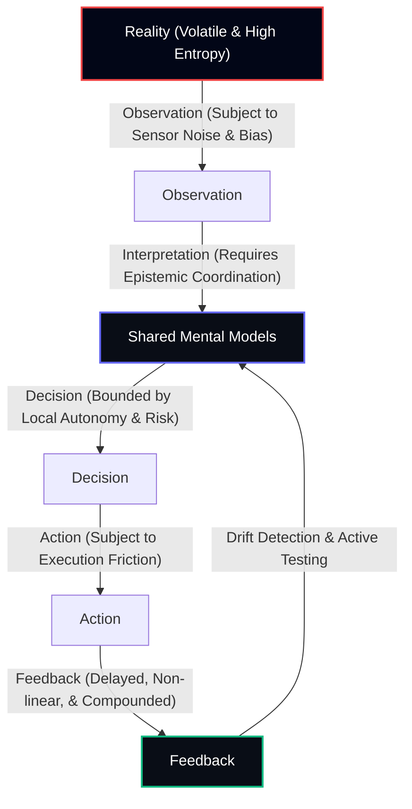
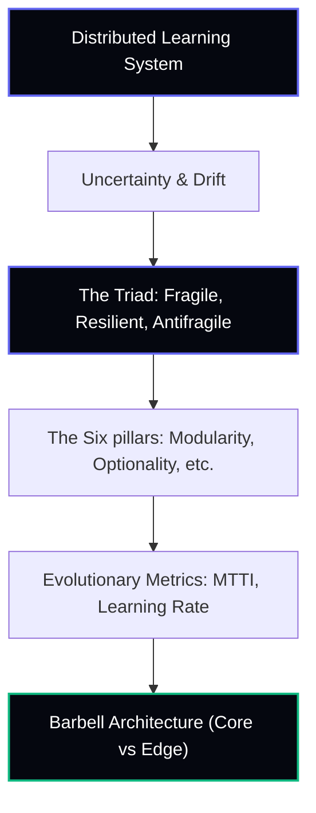

# Adaptive Organizations: Learning, Resilience, and Antifragility under Volatility

## Introduction
Mentat Commons conceptualizes the enterprise not as a static machine executing deterministic algorithms, but as a **Distributed Learning System**. In this view, organizations are cognitive systems that continuously observe reality, construct shared mental models, coordinate decisions, act, receive feedback, and update their models of customer behavior, market dynamics, and technological feasibility.

However, a cognitive system operating in a friction-free state behaves very differently from one subjected to external shocks. Volatility, uncertainty, and disruption are not merely external risks to be mitigated; they are the primary mechanisms that expose hidden model assumptions, reveal structural overfitting, and generate the information required for adaptation. 

This document establishes the theoretical framework for **Adaptive Organizations**, demonstrating that **Resilience** and **Antifragility** are not operational buffers, but emergent properties of how well-designed distributed learning systems manage uncertainty.

---

## 1. The Extended Organizational Learning Loop

The traditional Mentat Commons model maps organizational actions to a cybernetic feedback cycle:

$$\text{Reality} \longrightarrow \text{Observation} \longrightarrow \text{Shared Mental Models} \longrightarrow \text{Decision} \longrightarrow \text{Action} \longrightarrow \text{Feedback} \longrightarrow \text{Updated Models}$$

In environments characterized by extreme uncertainty, this loop is subject to noise, delays, and structural shifts. To remain adaptive, we extend the loop to incorporate systemic vulnerabilities and dynamics:



### Pathologies of the Loop under Stress:
1. **Concept & Model Drift**: The underlying rules governing customer utility or system parameters change (drift) during the observation-to-action cycle. If the learning loop's velocity is slower than the rate of environmental drift, the organization operates on obsolete models, leading to **organizational overfitting**.
2. **Feedback Delays**: In complex systems, the consequences of a decision are separated from the action in space and time. Delayed feedback loops mask structural flaws, leading organizations to scale fragile practices.
3. **Hidden Coupling**: Tight coupling between nodes in the learning system causes localized failures to cascade globally, overriding modular boundaries and blinding sensors.
4. **Nonlinear Feedback**: Small changes in inputs lead to exponential shifts in system outcomes. When feedback is non-linear, linear regression models of business operations fail, causing catastrophic misallocations of attention.

This loop applies uniformly across domains:
* **In Businesses**: Operationalizing market updates.
* **In AI Systems**: Continually adjusting classifiers in production against data drift.
* **In Supply Chains**: Dynamically routing assets in response to transport shocks.
* **In Software Platforms**: Observing system telemetry to dynamically provision resource pools.

---

## 2. The Three Evolutionary States of Organizations

Reinterpreting Nassim Nicholas Taleb’s triad through the lens of organizational learning reveals three distinct cognitive modes.

| Attribute | Fragile | Resilient | Antifragile |
| :--- | :--- | :--- | :--- |
| **Cognitive Goal** | Efficiency maximization under static assumptions | Preserving current state and returning to equilibrium | Learning, evolving, and growing stronger from stress |
| **Learning Speed** | Slow; occurs only after catastrophic failure | Reactive; updates models during post-disaster recovery | Continual; integrates minor stressors to prevent ruin |
| **System Coupling** | Tight and centralized (single sensor failures cascade) | Semi-modular with structural shock absorbers | Highly distributed and decoupled (autonomous experiments) |
| **Optimization Focus**| Just-In-Time optimization & KPI fixation | Redundancy, contingency plans, disaster recovery | Convex optionality and modular evolution |
| **Response to Stress** | Destruction of capability (ruin) | Survives stress but returns unchanged | Improves and reconfigures architecture |

### The Fragile State
The Fragile organization is designed for a singular, static model of reality. In the name of efficiency, it eliminates all redundancy (e.g., Just-In-Time inventory, single-supplier sourcing, zero-buffer compute limits). It prioritizes short optimization horizons and treats metrics as absolute goals (Goodhart’s Law). When a shock violates its static assumptions, its learning loop snaps: the organization has no sensors to understand the deviation, leading to complete structural breakdown.

### The Resilient State
The Resilient organization designs for survival. It anticipates disruptions by building static buffers: financial reserves, dual-sourced supply lines, duplicate compute hosts, and cold backups. When subjected to stress, the Resilient system absorbs the impact, maintains execution, and recovers to its original baseline. While robust, it does not learn from the stressor; it merely endures it, returning to the status quo without updating its fundamental models of the future.

### The Antifragile State
The Antifragile organization is built to harvest volatility. It treats stress as an information input. Instead of trying to shield itself from all disruptions, it encourages minor, localized stressors to continuously probe system boundaries (e.g., Chaos Engineering, red-team simulations, exploratory product releases). It relies on decentralized authority to act instantly on localized information. Because the system is modular, the ruin of a small cell does not compromise the core; instead, the feedback from that failure updates the global mental model, increasing the system's total adaptive capacity.

---

## 3. Generalizing Antifragility

Antifragility is not a supply-chain concept; it is a structural property of distributed cognitive systems.

```
                  ┌───────────────────────────────┐
                  │   ORGANIZATIONAL APPLICABILITY │
                  └───────────────┬───────────────┘
                                  │
         ┌────────────────────────┼────────────────────────┐
         ▼                        ▼                        ▼
  [AI Systems]          [Knowledge Systems]          [Leadership]
  Continual learning    Competing hypotheses       Decentralized authority
  Drift detection       Evidence freshness         Psychological safety
  Model evolution       Context refinement         Exploration allocation
         │                        │                        │
         ├────────────────────────┼────────────────────────┤
         ▼                        ▼                        ▼
 [Supply Chains]         [Software Systems]      [Org Structure]
  Optionality routing    Chaos engineering         Modular teams
  Strategic buffers      Observability loops       Reconfigurable units
  Decoupled sourcing     Graceful degradation      Adaptive governance
```

### AI Systems
* **Fragile**: Single monolithic models optimized on narrow historical sets. They collapse under domain drift.
* **Antifragile**: Continual learning architectures backed by automated drift monitoring and multi-model routing. Production systems actively run small A/B tests to explore out-of-distribution inputs, using failures to trigger automated retraining loops.

### Knowledge Systems
* **Fragile**: Static wikis and documentation hierarchies. Knowledge becomes obsolete without active maintenance.
* **Antifragile**: Semantic networks where competing hypotheses are documented alongside evidence weights. RAG retrieval engines continually refine themselves based on user queries, surfacing assumptions that conflict with incoming query patterns.

### Leadership
* **Fragile**: Command-and-control hierarchies where all decisions route to a centralized executive. Information is filtered, resulting in delayed models.
* **Antifragile**: Decoupled leadership focused on epistemic coordination. Authority is pushed to the edge where sensors are closest to reality. Leaders maintain a shared context rather than directing tasks, encouraging team exploration and safeguarding against systemic ruin.

### Supply Chains
* **Fragile**: Linear, single-provider pipelines optimized exclusively for cost.
* **Antifragile**: Multi-routed networks utilizing strategic inventory buffers and contract optionality. Real-time telemetry detects supply anomalies at source, automatically shifting route paths and triggering secondary sourcing commitments.

### Software Systems
* **Fragile**: Monolithic, highly coupled systems where a single database lock halts all API layers.
* **Antifragile**: Decoupled microservices utilizing circuit breakers, rate limiters, and graceful degradation states. Active chaos engineering (e.g. killing nodes randomly in production) ensures that failure patterns are routinely verified.

### Organizational Structure
* **Fragile**: Functional silos with rigid reporting lines. Reorganizations are traumatic events.
* **Antifragile**: Swarming, cross-functional cells that form and dissolve dynamically. Teams own their local interfaces, enabling modular changes to business units without disrupting the wider corporate topology.

---

## 4. The Six Structural Pillars of Adaptive Organizations

We translate these behaviors into design principles for enterprise architecture:

### 1. Optionality
Treat buffers as strategic assets rather than operational inefficiencies.
* **Mechanism**: Maintain excess capacity, diverse supplier matrices, modular software contracts, cash reserves, and hiring pools.
* **Convexity**: Designing positive convexity means ensuring that the cost of maintaining the option (small, bounded downside) is far outweighed by the benefits of exercising it during high-volatility events (unbounded upside).

### 2. Visibility
Move beyond passive, aggregate BI dashboards to real-time telemetry.
* **Mechanism**: Deploy anomaly detection, drift monitoring, and weak-signal aggregators.
* **Cognitive Function**: Visibility ensures that the *Observation* step of the learning loop captures reality accurately, highlighting raw discrepancies rather than smoothing out anomalies.

### 3. Modularity
Minimize dependencies between business nodes to contain failure domains.
* **Mechanism**: Define strict, documented interfaces between teams, services, and pipelines.
* **Cognitive Function**: Modularity prevents catastrophic propagation of stress. It allows localized learning experiments to fail safely, generating valuable lessons without threatening the survival of the enterprise core.

### 4. Adaptability
Design resources and workflows for dynamic reconfiguration.
* **Mechanism**: Establish infrastructure elasticity, continuous deployment practices, and flexible labor pools.
* **Cognitive Function**: Speeds up the transition from *Decision* to *Action*, closing the learning loop before external conditions shift again.

### 5. Coordination
Align distributed units through shared context rather than command hierarchies.
* **Mechanism**: Cultivate psychological safety, establish explicit decision rights, and maintain a unified semantic knowledge repository.
* **Cognitive Function**: Coordinates actions across decentralized cells, ensuring that local autonomy does not lead to global incoherence.

### 6. Continuous Learning
Institutionalize tools for continuous model validation and hypothesis updating.
* **Mechanism**: Run scenario planning simulations, post-mortem analyses, war games, and digital twins.
* **Cognitive Function**: Automatically updates the *Shared Mental Models* after every feedback cycle, ensuring that the organization learns from disruption rather than just recovering from it.

---

## 5. Replacing Static KPIs with Evolutionary Metrics

Traditional KPIs measure performance under static assumptions. Adaptive organizations prioritize indicators of learning and flexibility:

### Mean Time To Improve (MTTI)
$$\text{MTTI} = T_{\text{Improvement}} - T_{\text{Disruption}}$$
Measures the duration from the moment an anomaly is detected to the deployment of a permanent operational adjustment. Lower MTTI indicates a highly responsive learning loop.

### Organizational Learning Rate ($\lambda$)
$$\text{Impact}(t) = \text{Impact}(0) \cdot e^{-\lambda t}$$
Quantifies the reduction in negative business impact across repeated occurrences of similar disruptions. A higher learning rate indicates successful extraction of feedback into structural safeguards.

### Optionality Index ($OI$)
$$OI = \sum_{i=1}^{n} w_i \cdot \text{Flexibility}_i$$
A weighted index measuring the availability of alternative operating routes (e.g., proportion of dual-sourced raw materials, cross-trained staff, modular API paths).

### Adaptation Velocity
The time delay between the stabilization of new market/system data (e.g., data drift detection) and the execution of updated decision boundaries in business models.

### Epistemic Health Score
A metric auditing the freshness of evidence, the proportion of untested assumptions, the flow rate of feedback across silos, and database query accuracy.

---

## 6. The Organizational Barbell Strategy

We translate Taleb's Barbell Strategy into enterprise design by bifurcating the allocation of attention, capital, and organizational architecture:

```
                  ┌────────────────────────────────────────┐
                  │     THE ENTERPRISE BARBELL ALLOCATION  │
                  └───────────────────┬────────────────────┘
                                      │
         ┌────────────────────────────┴────────────────────────────┐
         ▼                                                         ▼
  [STABLE CORE: 80-95%]                                     [ADAPTIVE EDGE: 5-20%]
  - Focus: Reliability, compliance, core services           - Focus: R&D, experimentation, option testing
  - Goal: Protect against ruin                              - Goal: Capture volatility and positive convexity
  - Metric: Uptime, quality, security                       - Metric: Learning rate, feedback velocity
```

### Stable Core (80–95%)
This side of the barbell represents the operational engine of the business. It prioritizes compliance, high availability, standard operating protocols, robust infrastructure, and data security. It acts as the anchor, preventing catastrophic failure and ensuring steady execution.

### Adaptive Edge (5–20%)
This side of the barbell is designed to be highly volatile. It functions as an exploratory lab, running small-scale experiments, building prototypes, forming agile partnerships, and funding exploratory projects. It has no expectation of linear predictability; instead, it is built to capture unexpected tail events and positive convexity.

### Industry Allocations:
* **Core Technology Platforms**: 80% Core (high reliability API, compute clusters) / 20% Edge (custom LLM agent models, sandbox experiments).
* **Pharmaceuticals & R&D**: 60% Core (compliant manufacturing, safety protocols) / 40% Edge (speculative compound exploration).
* **Consumer Logistics**: 95% Core (standard carrier routing, automated sorting) / 5% Edge (adaptive drone routing, dynamic vendor testing).

---

## 7. Leadership Reinterpreted

In an adaptive organization, leadership transitions from a **command function** to an **epistemic systems function**. The leader's role is not to specify tasks, but to manage the cognitive health of the distributed learning loop:

1. **Allocating Organizational Attention**: Directing focus toward weak signals, ensuring that anomalies are not ignored or smoothed out by middle management.
2. **Epistemic Coordination**: Aligning context across autonomous teams. Pushing decision rights to the edge while maintaining a single source of truth to prevent model fragmentation.
3. **Preventing Overfitting**: Actively challenging historical models. Forcing teams to test assumptions by funding speculative exploration.
4. **Cultivating Optionality**: Rejecting near-term optimization if it destroys structural buffers, safeguarding the organization against systemic ruin.

---

## 8. Enterprise Architecture Through an Adaptive Lens

Enterprise Architecture (EA) is the formal design of adaptive capability. It governs the structural constraints that determine learning loop velocity:

* **Information Flow**: Designing asynchronous, pub/sub schemas that allow teams to publish data without forcing hard synchronization steps.
* **Organizational Topology**: Structuring teams with clear boundaries (e.g. Conways Law), preventing communication bloat and containment leaks.
* **Decision Architecture**: Defining clear decision boundaries (e.g. Type 1 vs. Type 2 decisions), allowing edge groups to move fast without senior sign-offs.
* **AI Architecture**: Integrating model hosting, drift evaluation, and validation loops directly into core engineering pipelines rather than isolating them in data labs.

---

## 9. Integrating AI Into Adaptive Learning Systems

AI is an accelerator of the learning loop, not just an automation tool.

### Where AI Enhances Antifragility:
* **Exploratory Copilots**: LLM agents query knowledge networks and surface anomalies that conflict with corporate operating models.
* **MLOps Drift Loops**: Automated drift pipelines capture operational shifts and update baseline predictions without human intervention.
* **Dynamic Agents**: System workflows dynamically routing queries based on real-time task complexity.

### Where AI Creates Fragility:
* **Over-Optimization**: Monolithic LLM models trained to optimize a specific path may eliminate operational buffers, increasing system fragility.
* **Hidden Coupling**: Directly linking model outputs to automated actions without safety guardrails or validation boundaries. A single model hallucination can cascade through downstream APIs, causing systemic failure.

---

## 10. Integration with the Mentat Commons Philosophy

This framework links directly with the core tenets of the Mentat Commons philosophy:



* **Distributed Learning System**: Stress acts as the primary data input that forces cognitive model revision.
* **Hypothesis-Driven Organizations**: We do not create static operations; we build hypotheses that are constantly tested against volatility.
* **Overfitting & Epistemic Coordination**: The barbell strategy separates the stable core (preventing overfitting in core engines) from the adaptive edge (maximizing search parameters for new horizons).

By viewing **Resilience** and **Antifragility** not as operational tasks, but as the natural outcomes of a well-functioning distributed learning system, Mentat Commons provides organizations with the tools to navigate volatility, adapt continuously, and emerge stronger from uncertainty.
